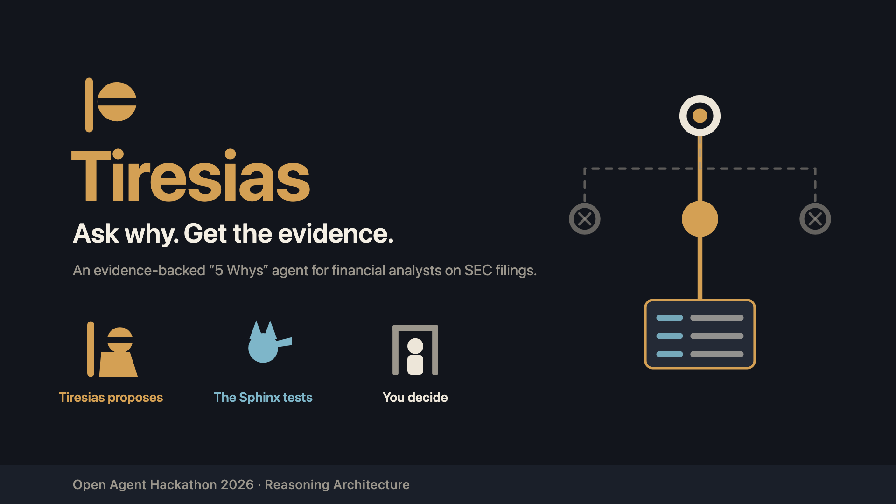

# Tiresias



[](https://github.com/Palmlore/Tiresias/actions/workflows/ci.yml)

**An evidence-backed "5 Whys" root-cause agent for financial analysts, built on SEC filings.**

> *Tiresias, the blind seer of Sophocles' Oedipus Rex, named the cause of Thebes' plague first, but had no evidence and was not believed. This Tiresias brings the evidence.*

| | |
|---|---|
| **Event** | Open Agent Hackathon 2026 (GenAI Works), 22–27 October 2026 |
| **Track** | Reasoning Architecture |
| **Team** | Palmlore (solo) |
| **Status** | 🚧 **Build window open until 27 Oct 2026.** Each section says what works today; nothing is marked working that you can't run. Progress: [docs/CHECKLIST.md](docs/CHECKLIST.md). |
| **Video** | **[youtu.be/ySNhg5ttZGk](https://youtu.be/ySNhg5ttZGk)** (3:41, unlisted): for now a walkthrough of the submission deck; the product demo (a live run through Zetaris and Nightshift) replaces it before the deadline. |
| **Try it online** | **[tiresias.palmlore.com](https://tiresias.palmlore.com)**: a demo-grade hosted copy of the web UI, sample mode only (cached SEC data, rules only), on deliberately small resources to keep its cost bounded: it can be slow or busy. Run it locally for live mode and full performance. It currently runs the 25 Oct build; the 26 Oct story view and decision prompts reach it at the next redeploy. |
| **Licence** | Apache-2.0 |

---

## The problem

A company's reported figures change between filings. 3M's 2023 revenue was **$32.68B** in its 2024 annual report and **$24.61B** in its 2025 one; GE's 2022 revenue was **$76.6B** in its 2023 annual report, **$58.1B** in 2024 and **$29.1B** in 2025. An analyst has to find out *why* before trusting a model built on those numbers. Today that means reading filings by hand across the parent company and the companies it spun off.

## What Tiresias does

You ask *"why did this figure change?"* and say **who is asking** (analyst, auditor, board). Tiresias:

1. **Drills down** through the sources it knows (filings, restated values, filing events), using SQL through **Zetaris**.
2. **Goes looking for missing evidence** when the known sources run out. It finds the entity it needs (for example the spun-off company), registers that company's filings as a new Zetaris source while it runs, and reconciles the numbers.
3. **Challenges every link** with a critic. Is it causal, or just a breakdown of the total? Would the effect disappear without it? How much does it explain, and what's left over?
4. **Stops at the first cause the asker can act on**, which can be before or after level 5. It always reports the end state: `actionable`, `branched`, `cyclic`, `evidence-frontier`, `external-driver` or `budget` (`cyclic` is not produced yet, [BACKLOG](BACKLOG.md) B-2).
5. **Remembers lessons, not answers** (Meterless **H-MEM**): a run that finds a cause stores the generic path that worked (no company, figure or date) behind a memory gate; the next similar question recalls it and tests that path first, so it takes fewer steps. The critic still tests every step and **rejects** a recalled lesson that doesn't fit. Memory can be **purged** (`POST /memory/purge`), so you can watch the difference (see Memory below).

Every step (query, hypothesis, critique, human-in-the-loop gate, source registration) is written to a JSONL trace, memory recall (ids and scores), the critic's call on each lesson, feedback and the write-back included. Each call to Zetaris, Nightshift or the memory service also records what went over the wire: endpoint, method, host, HTTP status and request/response sizes, never a key.

## Results on 12 companies we did not pick

Before running anything we committed a list of 12 US companies that spun off a business into a new SEC registrant (2019–2024, our own examples excluded), plus 3 controls, and ran each live through Zetaris (rules only, memory cold, gates on auto). Then every answer was re-checked against SEC EDGAR directly, outside Tiresias ([coverage-sweep-2026-10-26.md](docs/measurements/coverage-sweep-2026-10-26.md)):

- **No wrong number.** 6 companies got an answer: 3 reconciled to the right spun-off company within 5% (IBM → Kyndryl, Bath & Body Works → Victoria's Secret, Fortive → Ralliant), 1 found the right company but left 23.5% unexplained (DuPont → Qnity), and 2 measured the disposal on the parent's own restated filing (J&J, Merck). The audit found all 6 correct, 4 with caveats (a fiscal-year label, an extra candidate filing cited for J&J), none wrong.
- **Limited recall.** 5 runs stopped at the evidence frontier without claiming a cause. One stop was right (the buyer files nothing with the SEC); 3 could have been answered from XBRL (Danaher, Becton Dickinson: not filed as an 8-K item 2.01; RTX: two spun-off companies), so they are recall gaps ([limitations](docs/limitations.md), BACKLOG B-34–B-36). One ticker did not resolve.
- **Time.** Median 13.5 s per question once a company is registered (p90 22.3 s); registering a company Zetaris had not seen added a median 27.2 s. The controls behaved: a forecast was refused by the scope check, a non-spin-off stopped at the frontier.

## Quickstart (judges)

**No install:** open the demo-grade hosted copy, **https://tiresias.palmlore.com**, to use the web UI (see Web UI below) in sample mode. It runs the same image as `docker compose` with `PUBLIC_DEMO=true`: requests asking for live mode and the memory purge are refused (403), and H-MEM memory is shared by every visitor and resets when the server restarts. The hosted demo runs on deliberately small resources so its cost stays bounded: one instance (1 vCPU and 1 GiB for the agent, 1 vCPU and 512 MiB for the memory service), at most 4 runs at a time (a fifth gets 429 `TooManyRuns`: retry shortly), no autoscaling, no CDN, no login. Under load it is slow or busy rather than more expensive. Deployment: [deploy/gcp/](deploy/gcp/README.md).

**Works today: Loop A (the drill-down through registered sources) and Loop B (finding the missing entity in the SEC catalog, registering it behind a source gate and re-running the add-back test) in sample mode, offline, with no API keys** (`SAMPLE_MODE=true`, the default). It runs the real agent logic on a cached SEC slice ([data/sample/](data/sample/)); nothing is replayed. H-MEM memory works in sample mode too (the cognition service runs in the same `docker compose`; see Memory below). In live mode the agent also calls Nightshift models (see Models below). **A web UI** comes with it on http://localhost:8000 (see Web UI below); branching is still **planned**; [docs/CHECKLIST.md](docs/CHECKLIST.md) tracks it.

Needs Docker Desktop (or Docker Engine) with **Compose v2.24 or later** (`docker compose version`), ports 8000 and 8100 free, and about 750 MB of disk for the two images. The first build also pulls the Python and Node base images, which can take a few minutes; later builds take seconds.

```bash
git clone https://github.com/Palmlore/Tiresias && cd Tiresias
cp .env.example .env              # keep SAMPLE_MODE=true; no keys needed
docker compose up --build         # agent :8000, cognition :8100 (add -d to run in the background)

# open http://localhost:8000 in a browser for the web UI, or use the API:
# in another terminal: wait until the agent answers, then ask the lead example: why did 3M's 2023 revenue fall?
until curl -sf localhost:8000/health >/dev/null; do sleep 1; done
curl -s -X POST localhost:8000/run -H 'Content-Type: application/json' -d @input_examples/04_3m_2023_revenue_restated.json; echo

# then all four examples (each prints a RunResult JSON)
for f in input_examples/*.json; do
  curl -s -X POST localhost:8000/run -H 'Content-Type: application/json' -d @"$f"; echo
done
ls logs/                          # one JSONL trace per run: logs/trace-<run_id>.jsonl
```

The `trace_file` in each reply is the path inside the container (`/app/logs/…`); on your machine the same file is under `logs/`.

Each result leads with the decision: `end_state` (`actionable`, `evidence-frontier`, …) and the recommended `action`, then the `effect`, the `why_tree` (each link with its SQL, rows and the critic's verdict), the `residual` (share of the effect left unexplained; negative when over-explained) and `stats`. In sample mode all four examples end `actionable`. The lead one, **04 (3M)**: 3M's 2023 revenue was restated from $32.68B to $24.61B; Loop A traces the drop to 3M's 8-K disposal filing (items 2.01, 9.01, filed 2024-04-04) and stops at the evidence frontier, because the missing revenue lives in another registrant; Loop B finds that registrant from filing evidence, not its name (Solventum Corp, the filer whose Form 10 names 3M, from an EDGAR full-text search the sample caches), registers it behind the source gate and reconciles: Solventum reports $8.20B, so the add-back over-explains by $126M (`residual` −0.0156). 01 and 02 reconcile GE's restatements to GE HealthCare and GE Vernova the same way, and 03 stops at GE's goodwill impairment. Write your own question in the same shape as [input_examples/](input_examples/) (schema: `RunRequest` in [contracts/openapi/agent.yaml](contracts/openapi/agent.yaml)); a malformed body gets a structured 422.

### Web UI

Open **http://localhost:8000** once the stack is up (it redirects to `/ui/`). Story: drag the carousel and click one of the three example questions. Truth: search a company and click one of the questions Tiresias found in its filings:

- **Story view (default)**: drag the carousel and click a question. A single progress bar fills Understand → Recall → Drill down → Fetch missing data → Answer; click a segment to wind back. Tiresias and the Sphinx speak in short lines from the Odyssey and Oedipus Rex (the seer who hears, then the riddle); expand "What I hear" / "The riddle" for the chain of thought. The analyst opens with "O wise one, I have a question to ask." A waiting decision pins under the bar with what Proceed will take, so you do not scroll to find it. The why-tree stays the scoreboard beside the conversation. Click a tree node for SQL in the cellar.
- **Settings (⚙)**: Story defaults to "Pause at each decision (5 s to take over)": the Sphinx asks each decision on your behalf and proceeds with the recommendation after 5 s, unless you press **Take over**. Take over is your call, full stop: the gate is held (`POST /runs/{id}/gates/{gate_id}/hold`), no countdown or server deadline applies the recommendation any more, and a card (Situation, Task, Action, expected Result) waits for your choice with the recommended option highlighted. Only the run's wall-clock budget still bounds it; if that runs out, nothing is applied on your behalf and the run stops at end state `budget`. Switch to Automatic if you want Tiresias to follow its recommendation with no pause. Memory warm or cold; depth (live only).
- **Truth**: the full three-column page (Ask / Investigation / Evidence): companies and questions, the streamed trace with its SQL, the result, the why-tree, the evidence panel and the H-MEM lessons. Geometric 16 px character marks, not the Story portraits.

The UI only shows what the API returns: no figure is computed or kept in the browser. "Download trace" saves the run's trace lines as streamed. A badge in the header says whether the agent runs in sample mode (cached SEC data, rules only) or live.

**Watch a run live.** Pass your own run id with `X-Run-Id` (it is echoed, stamped on every trace line and names the trace file), start the run in the background, and stream its trace as Server-Sent Events. A run id can be used once (reusing it returns 409 `RunConflict`), so pick a new one each time you repeat this:

```bash
curl -s -X POST localhost:8000/runs -H 'Content-Type: application/json' \
     -H 'X-Run-Id: my-run-1' -d @input_examples/04_3m_2023_revenue_restated.json   # 202 {"run_id": "my-run-1", ...}
curl -sN localhost:8000/runs/my-run-1/events      # one trace line per event, then "event: end"
curl -s  localhost:8000/runs/my-run-1             # {"status": "done", "result": {...RunResult...}}
```

**Answer a gate.** With `"options": {"hitl_mode": "interactive"}` the run stops at each human-in-the-loop gate (critic escalation, source registration, memory) and waits for you; the stream shows a `gate`/`waiting` line, and with no answer within `GATE_TIMEOUT_SECONDS` (default 120) the agent's own proposal applies (`decided_by: "timeout"`):

```bash
jq '.options.hitl_mode = "interactive"' input_examples/01_ge_2022_revenue_restated.json > /tmp/01-interactive.json
curl -s -X POST localhost:8000/runs -H 'Content-Type: application/json' -H 'X-Run-Id: gate-1' -d @/tmp/01-interactive.json
curl -s localhost:8000/runs/gate-1/gates          # waiting_gate: {"gate_id": "g1", "gate": "critic_escalation", "options": ["frontier", "prune"], "proposal": "frontier", "context": {...}, "deadline": "..."}
curl -s -X POST localhost:8000/runs/gate-1/gates/g1 -H 'Content-Type: application/json' -d '{"choice": "frontier"}'
curl -s localhost:8000/runs/gate-1/gates          # g2: the source gate, "Register ... GE HealthCare ...?"
curl -s -X POST localhost:8000/runs/gate-1/gates/g2 -H 'Content-Type: application/json' -d '{"choice": "deny", "note": "not today"}'
curl -s localhost:8000/runs/gate-1                # done: end_state evidence-frontier, "source gate (interactive, human) denied ..."
```

A choice that is not an option is a 422, answering twice or after the deadline a 409. The CLI asks on stdin instead: `uv run python -m tiresias_agent.orchestrator ../../input_examples/01_ge_2022_revenue_restated.json --interactive`.

**Without Docker** ([uv](https://docs.astral.sh/uv/); it fetches Python 3.11+ if needed). Stop the Docker stack first (`docker compose down`), or give the app another port, because both use :8000. The app runs in the foreground, so run the CLI line in a second terminal:

```bash
cd services/agent && uv sync
uv run python -m tiresias_agent.app                       # same API on :8000 (or: AGENT_PORT=8001 uv run python -m tiresias_agent.app)
uv run python -m tiresias_agent.orchestrator ../../input_examples/04_3m_2023_revenue_restated.json   # CLI: RunResult on stdout
```

Live mode (`SAMPLE_MODE=false` or `"options": {"sample_mode": false}`) queries a local Zetaris and falls back to the sample per call if it is unreachable. Every read, including the discovery of a missing entity, goes through Zetaris. See [deploy/README.md](deploy/README.md).

### Sample inputs, outputs and traces

[input_examples/](input_examples/) holds four questions; [output_examples/](output_examples/) holds the result of each from a real run, and [logs/samples/](logs/samples/) the trace of that run (one JSON line per agent action: the SQL sent to Zetaris and the rows it returned, each hypothesis, the critic's verdict, every gate decision, every memory call and, in a live run, every model call with the model that served it). The four sample-mode results come from the quickstart above; two results for case 04 come from live runs, one from a fresh Zetaris at depth `deep` with each Nemotron call and its receipt in the trace, and give the same root cause and residual. How each was produced: [output_examples/README.md](output_examples/README.md). They are never read at runtime: the agent recomputes every answer.

### Memory: cold, warm, a rejected lesson, purge

With the stack up, one command runs the H-MEM demo (sample mode, stdlib Python, under a second):

```bash
python3 scripts/memory_demo.py            # --agent http://localhost:8000 by default
```

It purges memory, then runs 04 (3M, empty memory: stores the spin-off lesson), 01 (GE HealthCare, warm: recalls it, tests the 8-K disposal first and leaves the two other candidates untested), 03 (GE's impairment: the same lesson is recalled, its step is pruned, and the critic rejects the lesson with `not_helpful` feedback), purges again and re-runs 01. Output on 2026-10-24 (docker compose, sample mode):

```
A  04 3M spin-off, empty memory       end_state=actionable hops=5 queries=7 recalled=- skipped=- feedback=- stored=mem-1
B  01 GE spin-off, warm               end_state=actionable hops=3 queries=6 recalled=['mem-1:supported(0.3127)'] skipped=['n0.2', 'n0.3'] feedback=['mem-1:helpful'] stored=-
C  03 GE impairment, warm             end_state=actionable hops=4 queries=5 recalled=['mem-1:rejected(0.2967)'] skipped=- feedback=['mem-1:not_helpful'] stored=mem-2
4  purge                              purged=2 (cognition confirmed)
B' 01 GE spin-off, after purge        end_state=actionable hops=5 queries=7 recalled=- skipped=- feedback=- stored=mem-3
```

Each result carries `memory` (mode, recalled lessons with the critic's call, skipped candidates, feedback, the lesson stored) next to `stats`. The end state, root cause and action are the same warm or cold; a warm why-tree leaves out the candidates the lesson made unnecessary (listed in `memory.skipped`), and if a lesson's shortcut ever finds no cause, Loop A runs again in full (`memory.fallback`). Per request: `"options": {"memory": "cold"}` makes no memory call; `MEMORY_MODE=off` turns memory off for every run. If cognition is down, runs go on without memory (one `degraded` trace line). `curl -s -X POST localhost:8000/memory/purge` reports only the count cognition confirmed (503 if it is unreachable); cognition's trust ledger keeps the purge event. Design: [ADR-0005](docs/decisions/ADR-0005-memory-lessons-purgeable.md).

### Ask about your own company

- **Sample mode (default, offline) covers the GE family and 3M/Solventum only**: GE, GE HealthCare, GE Vernova, 3M and Solventum, because [data/sample/](data/sample/) is a cached slice of their SEC filings plus the one EDGAR full-text search the 3M case needs (that is what lets it run with no keys). Any other company ends in well under a second at `evidence-frontier`, with a reason that lists the slice's companies and says how to run live.
- **Live mode works for any SEC registrant.** Name it by ticker, CIK or name (`"entity": {"ticker": "IBM"}`, `{"cik": "0000051143"}` or `{"name": "Hilton Worldwide Holdings Inc."}`). Tiresias resolves it through the SEC ticker list registered in Zetaris, asks the source gate, and registers the company's filings in Zetaris while the run is going. Measured on 2026-10-23 ([docs/measurements/live-any-company.md](docs/measurements/live-any-company.md)): **the first question about a new company takes about 15–21 s** (12–16 s of it is Zetaris downloading the company's SEC facts once); **the next one takes 3–11 s**. Progress shows on the trace stream as `phase_start` / `heartbeat` / `phase_done` lines.
- **Pick a company / suggested questions.** `GET /entities?q=…` lists the companies ready now (registered; in sample mode the slice: GE, GEHC, GEV, MMM, SOLV, and it says why nothing else) and, live, type-ahead over every SEC registrant, each with its expected first-run wait (the measured 3–11 s or 15–21 s). `GET /entities/{cik}/suggestions` derives questions from that company's own filings (restatements, the largest year-on-year changes), each checked by the framer and returned as a request you can post to `/run` as-is. Some end at `evidence-frontier`: that shows where the rule set stops, with the reason, not a failure.
- **Out-of-scope questions stop at once, with alternatives.** A forecast or what-if ("What would … if …?"), or a company that is not an SEC registrant, ends at `evidence-frontier` with a plain reason in `RunResult.scope` and up to three runnable alternatives checked against filed data (an SEC registrant the question names, the same company's latest filed change, a same-industry peer). In sample mode a company outside the slice gets the reason and how to run live, usually with no alternatives (the slice has no peers to offer).
- Not every company gets a full answer: the rule set is small (disposals, impairments, restatements). Loop B finds a spun-off business by its filings, not its name: the new registrant whose Form 10 names the parent (IBM → Kyndryl, 3M → Solventum), found with EDGAR full-text search through Zetaris; a sale to an existing company is refused with the buyer named (DuPont → IFF), and two spin-offs on one day are followed one at a time (Hilton: the best-ranked, the rest stays in the residual). In the measurements GE, IBM, 3M, Crane NXT, J&J and Hilton end `actionable`; DuPont (a sale), Caterpillar and ExxonMobil end at `evidence-frontier`, each with the reason.

### Check it yourself: tests

```bash
cd services/agent && uv run --group dev pytest -q           # agent: loops, critic, gates, adapters (Zetaris and Nightshift mocked), API
cd services/cognition && npm test && npm run conformance     # H-MEM service tests; the official H-MEM conformance suite (13/13)
./scripts/check_secrets.sh && ./scripts/validate_metadata.sh # no committed secrets; metadata.json valid
```

Stop the Docker stack before running the agent tests: with the cognition service up, some sample runs in the tests recall lessons it stored and fail (BACKLOG B-27). CI runs all of these, plus the Docker quickstart and the memory demo, on every change.

## Dependencies

| Needed for | What |
|---|---|
| Sample mode (the default) | Docker with Compose v2.24+, or Python 3.11+ with [uv](https://docs.astral.sh/uv/) (and Node ≥ 22.18 for the cognition service). No keys, no network after the build. |
| Live mode: data | **Zetaris**, the local Docker bundle (`zetaris-platform` 2.4.3.1), REST on `localhost:8888`; `ZETARIS_REST_URL`, `ZETARIS_ORG_ID`, `ZETARIS_API_KEY` and `SEC_USER_AGENT` in `.env`. See [deploy/README.md](deploy/README.md). |
| Live mode: models (depth `thorough` or `deep`) | **Meterless Nightshift** (run on 1.2.1 and, from 26 Oct, 1.2.4, macOS), its OpenAI-compatible Runtime; `METERLESS_BASE_URL` and `METERLESS_RUNTIME_TOKEN` in `.env`; optionally `METERLESS_MODEL_FAST` / `METERLESS_MODEL_DEEP` to pin Nemotron model ids (1.2.4; the ids are in `.env.example`). The NVIDIA key is set in Nightshift's Providers tab, never in this project. |
| Memory | The `cognition` service (Meterless H-MEM, vendored), started by `docker compose`; without it runs go on without memory. |

Every external call has a timeout and a fallback: if Zetaris or Nightshift is unreachable, the run degrades to the sample data or to the rules and says so in its trace, instead of failing. Placeholders for every variable: [.env.example](.env.example).

## Where to look (judging criteria → repository)

The full cross-reference is in **[docs/RUBRIC.md](docs/RUBRIC.md)**.

| Criterion | Start here |
|---|---|
| Impact (30) | [docs/problem-and-users.md](docs/problem-and-users.md) |
| Technical (20) | [docs/architecture.md](docs/architecture.md), [docs/decisions/](docs/decisions/), `services/` |
| Innovation (15) | [docs/causal-criteria.md](docs/causal-criteria.md) |
| Demo (15) | [docs/demo-plan.md](docs/demo-plan.md), `input_examples/`, `output_examples/`, `logs/samples/` |
| Product & UX (10) | [docs/problem-and-users.md](docs/problem-and-users.md) (asker profiles, branching), [docs/use-cases.md](docs/use-cases.md) (the analyst's working loop, screens, demo stories) |
| Sponsor Tech (10) | [docs/sponsor-technology.md](docs/sponsor-technology.md), [metadata.json](metadata.json) |

## Repository layout

```text
services/agent/       Python (FastAPI): orchestrator, agents, Zetaris adapter, Nightshift client, /run, tracing
services/cognition/   TypeScript (Node): Meterless H-MEM engine service and its conformance tests
contracts/openapi/    REST contracts between the services (written before the code)
catalog/              Bounded source catalog: the only sources the agent may discover
zetaris/sql/          Lightning SQL that registers the sources in Zetaris
zetaris/usl/          A Zetaris Unified Semantic Layer over case 04's evidence, its data-quality rules and queries
data/                 Offline sample slice (cached SEC data) and how it was fetched
input_examples/       Sample questions (4: the 3M lead case 04 and three GE cases)
output_examples/      Real outputs from real runs (never read at runtime)
logs/                 Run traces (logs/samples/ holds committed example traces)
deploy/               Local (Docker Compose) and cloud notes (GCP, AWS)
docs/                 Checklist, architecture, decisions (ADRs), criteria, sponsor tech, data sources, status
AGENTS.md             Handover for coding agents (CLAUDE.md imports it)
scripts/              Checks and tools: secrets scan, metadata validation, memory demo, live probes, verifier audit
metadata.json         Sponsor and submission metadata (community schema 0.1)
```

## Models

**The model proposes, the rules and the data decide** ([ADR-0010](docs/decisions/ADR-0010-model-lanes.md)). Three lanes can call Meterless Nightshift: a fast lane proposes extra candidate causes from the evidence vocabulary the source can query (each is then measured with SQL and judged by the rule critic like any other), a deep lane gives the critic an independent second opinion (a disagreement goes to the `critic_escalation` gate, whose auto policy keeps the rule verdict; the opinion is on `why_tree[].model_opinion`), and a fast lane may reword the action (used only when it adds no number or name).

Model calls are slow, so **you choose the depth per question** (`"options": {"depth": "thorough"}`, or `--depth` on the CLI; [ADR-0011](docs/decisions/ADR-0011-investigation-depth.md)) and are told the expected wait before the run starts (`depth.expected_wait` in the `POST /runs` 202 body, `expected_first_run_by_depth` on every `GET /entities` entry, and `RunResult.depth`):

| Depth | What runs | Expected wait, live |
|---|---|---|
| `quick` (default) | rules only, no model call | 3–11 s if Zetaris has the company, 15–21 s if the run registers it first |
| `thorough` | rules + the critic's deep-lane second opinion | about 1.5 min more on Nightshift 1.2.1 (three deep calls took 91–94 s on case 01, 24 Oct); on 1.2.4 with the deep lane pinned to Nemotron 3 Ultra, the 3M case took 23.5 s end to end (26 Oct, trace not committed) |
| `deep` | every lane: model hypotheses, the critic's second opinion, the action's wording | about 2.5 min more (91–94 s + about 51 s for the wording; 169–173 s end to end on case 01) |

Measured live on 2026-10-24 (model) and 2026-10-23 (rules); per call on 2026-10-26 (1.2.4, 8 calls each): Nemotron 3 Ultra 1.3–3.2 s, Nemotron 3.5 Lightning 11–46 s, no errors. Every reply is requested as JSON (`response_format: json_object`); without it Ultra wrote its reasoning before the JSON and its replies were rejected. Every call is traced with the lane, the requested lane id and the `routed_model` from Nightshift's receipt (Nemotron models on 2026-10-24), and counted in `stats.model_calls` (cap `MAX_MODEL_CALLS_PER_RUN`, default 12). Without a configured Runtime, or if Nightshift is down, the run continues on the rules (`depth.degraded: true`). **Sample mode uses the rule lanes only** and makes no model call at any depth, in milliseconds. `MODEL_LANES` is the operator's override: `off` forces `quick` everywhere, `on` means `deep` when a request names no depth; the older `options.model_lanes` is deprecated (`on` = `deep`, `off` = `quick`).

## Sponsor technology (summary)

| Sponsor | Role in Tiresias | Status |
|---|---|---|
| **Zetaris** | **The data layer.** In live mode every read is SQL through Zetaris: resolving the asked company (the SEC ticker list as a Zetaris table), its facts and filings, the discovery of a spun-off business (EDGAR full-text search as a Zetaris table), and registering that business's filings as a new Lightning REST table while the run goes on. Every claim in a result carries its SQL and the rows returned; every call is a trace line (SQL, outcome, rows, duration, retries, and the HTTP exchange: endpoint, status, bytes). | **working**: a live run from a fresh Zetaris is committed with every call traced ([logs/samples/](logs/samples/), [output_examples/README.md](output_examples/README.md)); more runs are measured in [docs/measurements/live-any-company.md](docs/measurements/live-any-company.md) and in the 15-company live sweep ([coverage-sweep-2026-10-26.md](docs/measurements/coverage-sweep-2026-10-26.md)). The default quickstart is sample mode, which runs the same logic on cached rows without Zetaris. Case 04's evidence is also modelled as a Zetaris **Unified Semantic Layer** with data-quality rules: one SQL statement over it reproduces the agent's $126M residual, and its rules surface the parent–spin-off link and the facts whose filing cannot be traced ([docs/zetaris-usl.md](docs/zetaris-usl.md)); the agent itself does not read it yet |
| **Meterless: H-MEM engine** | **Memory of lessons, not answers.** After a run finds a cause, the generic path that worked (no company, figure or date) is stored behind a memory gate; the next similar question recalls it and tests that path first, the critic rejects a lesson that doesn't fit, and memory can be purged. Test: the official H-MEM conformance suite passes 13/13 against our service, plus `npm test`; the feature is shown by `scripts/memory_demo.py` (in CI) and in the committed traces (run 02 recalls run 01's lesson). | **working**: H-MEM runs in every warm run, sample mode included, so the quickstart shows it |
| **Meterless: Nightshift** | **The only AI provider.** Every model call goes to Nightshift's Runtime (`POST {METERLESS_BASE_URL}/chat/completions`, OpenAI format, bearer Runtime token, `meterless-app: tiresias`, `meterless-scope: user`) for three lanes: extra candidate causes, a second opinion for the critic, the action's wording. Replies are requested as JSON; each call's trace line carries the lane, the routed model, the receipt id and the HTTP exchange. The model proposes; the rules and SQL decide ([ADR-0010](docs/decisions/ADR-0010-model-lanes.md)). | **working, with [caveats](docs/sponsor-technology.md#what-the-model-call-trace-shows-and-what-it-does-not)**: a live run from a fresh state at depth `deep` is committed with each call's lane, routed model and receipt id ([logs/samples/](logs/samples/)). Only live mode at depth `thorough` or `deep` calls a model ([ADR-0011](docs/decisions/ADR-0011-investigation-depth.md)), so the quickstart (sample mode) does not; in that run the hypothesis lane made no call and one of four replies was unusable and rejected |
| **NVIDIA** | **Nemotron serves the lanes through Nightshift**: the fast lane (hypotheses, wording) and the deep lane (the critic's second opinion). Nightshift 1.2.1 routed by lane and ignored model ids; 1.2.4 honours a pinned id (`METERLESS_MODEL_FAST` / `METERLESS_MODEL_DEEP`). Either way each call's trace line records the `routed_model` and receipt id: we claim only the model the receipt names. | **working, with [caveats](docs/sponsor-technology.md#what-the-model-call-trace-shows-and-what-it-does-not)**: in the committed fresh-state run all four calls were served by Nemotron (`nemotron-3-ultra-550b-a55b` once, its reply rejected as prose; `nemotron-3.5-super-vl-120b-a12b` three times); `nemotron-3.5-lightning-30b-a3b` also served calls on 2026-10-24 in a run whose trace is not committed. In that run (1.2.1) Nightshift picked the model, not us; on 26 Oct (1.2.4, lanes pinned) a live 3M run at depth `thorough` used 3 of 3 second opinions from `nemotron-3-ultra-550b-a55b` (measured, trace not committed) |
| **Cursor** | Optional under the rules, and used: Cursor's agent (Grok 4.6, medium) drew the brand assets (palette, mark, three characters) and carries the web UI's visual polish; Claude Code built the agent, services and docs ([docs/ai-usage.md](docs/ai-usage.md#development-tools)). Not a dependency. | working (assets #42, Story UI polish #58; both run in the quickstart UI) |

**What is unique:** Zetaris is a data layer that **grows during the run**: when the evidence runs out, the agent finds the missing company from filing evidence and registers its filings as a new Zetaris source behind a human gate, then reconciles. H-MEM remembers **how** a cause was found, never **what** it was, and its critic can reject a recalled lesson in the open. Models are used where they help and **never decide**, and each call names the model that actually answered.

Details: [docs/sponsor-technology.md](docs/sponsor-technology.md). Status is only `working` when a judge can see it run, or verify it in a committed trace from a fresh state that records every call.

## Future enhancements

- **Harden the hosted demo:** put an external HTTPS load balancer with Cloud Armor in front (per-visitor rate limits, WAF rules, bot filtering) and close the service's direct `run.app` URL. Left out of the demo because it adds a fixed monthly cost; the demo's cost is bounded instead by one small instance ([deploy/gcp/](deploy/gcp/README.md)).
- **Live mode in the cloud:** Zetaris on a private VM next to Cloud Run; Nightshift on a server once Meterless confirms server use is supported.
- **Zetaris storage that scales with companies:** load each company's facts once into one tall Parquet table (one row per reported number), as Zetaris advised, instead of caching wide JSON tables, which grows the driver's heap with every company ([BACKLOG](BACKLOG.md) B-24).
- **Broader reasoning:** more hypothesis rules and real cycle detection (B-2), the add-back test beyond restatements (B-6), branching from any node of a finished run (`/runs/{id}/branch`), a disclosure guardrail for sensitive findings, and narrative text (MD&A, press releases) beyond structured XBRL data.
- **Say it on the result when live data fell back to the sample** (a run-level flag; B-26).

## Data

Public SEC EDGAR APIs (XBRL company facts, filing histories, ticker map) and company_dns industry codes. The offline sample is a small cached slice with source URLs and fetch dates. See [docs/data-sources.md](docs/data-sources.md). No personal or confidential data is used.

## AI and model usage, limitations, third-party code

- [docs/ai-usage.md](docs/ai-usage.md)
- [docs/limitations.md](docs/limitations.md)
- [NOTICE](NOTICE)

## Pre-existing components

None. All code in this repository was written during the build window, which opened on 22 Oct 2026 at 00:00 UTC. Third-party open-source components are listed in [NOTICE](NOTICE).
