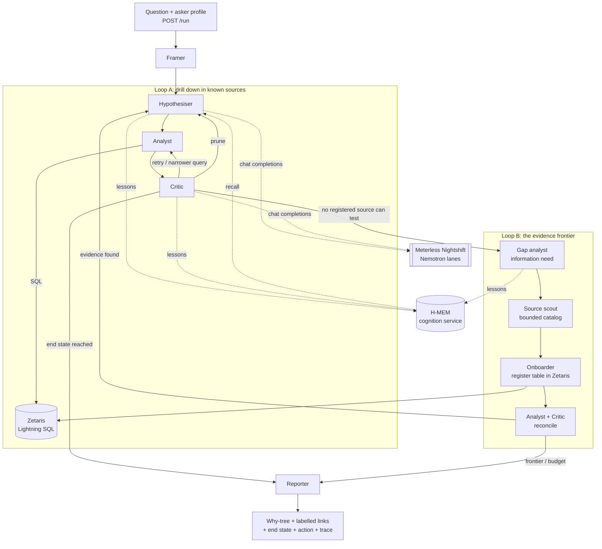

# Architecture

Status: **design.** Decisions are recorded in [decisions/](decisions/), and the critic's rules are in [causal-criteria.md](causal-criteria.md).

## Overview

## Services (split by service boundary, see ADR-0002)

| Service | Language | Responsibilities | Port |
|---|---|---|---|
| `agent` | Python 3.11+, FastAPI | Orchestrator and agents, Zetaris adapter, Nightshift model client, HITL gates, `/run` and branching API, JSONL tracing | 8000 |
| `cognition` | TypeScript, Node | Meterless **H-MEM** reference engine behind REST: recall, remember, feedback, purge, ledger. Official conformance suite. Markovian and World Model may join later. | 8100 |
| Zetaris | vendor images (Docker) | Federated SQL over SEC REST sources; source registration while running | 8888 (REST) |
| Nightshift | desktop app (host) | OpenAI-compatible model runtime with Nemotron lanes | 8088 |

The services talk over REST/JSON. Contracts are in [`contracts/openapi/`](../contracts/openapi/) and are written before the code.

## Agents

| Agent | Role | Authority |
|---|---|---|
| Framer | Turns the question and asker profile into the metric, entity, periods and size of the change | — |
| Hypothesiser | Proposes 2–3 candidate causes per level, seeded by recalled lessons | — |
| Analyst | Writes and runs SQL through Zetaris; measures each candidate's share of the effect | — |
| Critic | Applies [causal-criteria.md](causal-criteria.md): labels each link and accepts, prunes, retries or escalates | **Can block** |
| Gap analyst | When no registered source can test any candidate, writes the information need (variable, entity, period, join key) | — |
| Source scout | Chooses a template from the bounded [catalog](../catalog/) and resolves the join key | Only from the catalog |
| Onboarder | Registers the new source in Zetaris (dry run first, one statement at a time), behind the source gate | Gate-controlled |
| Reporter | Builds the why-tree, labels, end state, action and residuals | — |
| Memory | Recalls H-MEM lessons after the framer (warm runs), hands their steps to the hypothesiser, sends the critic's verdict on each lesson back as feedback, and distils a successful run's path into a generic lesson behind the memory gate ([ADR-0005](decisions/ADR-0005-memory-lessons-purgeable.md)) | Gate-controlled; the critic decides whether a lesson fits |

## Human in the loop (ADR-0006)

| Gate | Decision | Modes |
|---|---|---|
| Framing | Asker profile (role, levers, horizon) | input |
| Source gate | Register a new source in Zetaris | `interactive` / `auto` / `scripted` |
| Critic escalation | Accept or reject a link when the margin is too small | same |
| Memory gate | Store a lesson in H-MEM (options `store` / `discard`; auto: store) | same |

Modes (`options.hitl_mode`, else `HITL_MODE`, default `auto`): `auto` follows the requesting agent's proposal; `scripted` takes `options.decisions` (`"<gate>:<node_id>"` or `"<gate>"`); `interactive` asks a person. Over HTTP, an interactive run waits at each gate on its own thread (other runs and the API stay responsive): the trace and the SSE stream carry a `gate`/`waiting` line (`gate_id`, question, options, proposal, node_id, requested_by, a scrubbed `context` with the evidence the decision rests on, `deadline` in UTC); `GET /runs/{id}` shows it as `waiting_gate`, `GET /runs/{id}/gates` lists every gate, and `POST /runs/{id}/gates/{gate_id}` `{"choice", "note"}` answers it (`gate`/`answered`, `decided_by: "human"`) and the run resumes with that choice. With no answer by `GATE_TIMEOUT_SECONDS` (default 120, never past the run budget left) the gate expires (`gate`/`expired`, status `degraded`) and the proposal applies with `decided_by: "timeout"`, so a run never hangs. The CLI's `--interactive` asks on stdin.

### Memory in a run (agents/memory.py)

Warm (`options.memory`, default `MEMORY_MODE=warm`): after the framer, one recall whose query names only the kind of effect and the metric family. A recalled lesson is a path of generic steps (`rule=key>outcome`); the hypothesiser tests candidates with those steps first (node ids keep the rules' order). When the critic prunes a lesson's step, the lesson is rejected for the run and H-MEM gets `wrong` (same kind of question) or `not_helpful` (misapplied). When the step holds as recorded on the same kind of question, the level's other candidates are not tested (fewer hops; listed in `RunResult.memory.skipped`); if the run then reaches no cause, Loop A runs again testing everything. A run ending `actionable` or `branched` stores its path behind the memory gate, unless the same path is already stored. Cold: no memory call. Cognition down: one `degraded` line, the run goes on without memory.

Judges run in `auto` mode. After a run, a user can **branch** from any node of the why-tree with a new question or another asker profile. The branch is a new run carrying `parent_run_id` and `parent_node_id`.

## Budgets

These are the planned defaults, tunable through environment variables:
- depth ≤ 5 causal levels;
- ≤ 3 branches per level;
- ≤ 2 sources onboarded per run;
- external request 20 s; model request 180 s (Nightshift cold loads take minutes);
- total run ≤ 10 min.

## Tracing

Every action is one JSONL line in `logs/trace-<run_id>.jsonl` and is also printed to stdout. Both services write to the shared `logs/` volume and propagate `X-Run-Id`. Planned fields:

`timestamp, run_id, parent_run_id, node_id, agent, action, input_summary, output_summary, target_agent, sql, rows, share_explained, label, confidence, gate, gate_mode, decided_by, memory_ids, model, lane, requested_model, routed_model, provider, receipt_id, latency_ms, proposed_by, retry_count, status, outcome, duration_ms`

Gates: every decision is one `gate`/`decide` line (`gate`, `gate_mode`, `decided_by`: `policy:<gate>`, `script`, `human` or `timeout`; interactive lines add `choice`, `note`, `gate_id`). An interactive gate is first a `gate`/`waiting` line (`gate_id`, `options`, `proposal`, `context`, `deadline`, `timeout_seconds`), then `gate`/`answered` or `gate`/`expired`.

`outcome` names a benign result under `status: success`: for example a registration step whose object already `exists`, or a concept view that is `absent`; such steps are never traced `error`.

Slow phases are bracketed for progress UIs: `agent: orchestrator`, `action: phase_start` / `phase_done` (with `phase`, `target_agent` = the agent doing the work, and `duration_ms` on `phase_done`), plus `action: heartbeat` (`phase`, `elapsed_ms`) every `PHASE_HEARTBEAT_SECONDS` (default 5) while a phase runs. Phases: `resolve_entity`, `register_entity` (live, unregistered entity only), `loop_a` ⊃ `frame`, `loop_b` ⊃ `scout`, `onboard`, `reconcile`. Measured durations: [measurements/live-any-company.md](measurements/live-any-company.md).

## Modes

| Mode | Data | Models | Memory |
|---|---|---|---|
| Live | Zetaris (local Docker) → SEC APIs | Rules decide. By the run's depth (`options.depth`, ADR-0011): `quick` (default) rules only; `thorough` adds the critic's Nightshift second opinion; `deep` also lets the model propose extra candidates and word the action (ADR-0010) | cognition service |
| `SAMPLE_MODE=true` | Cached rows in `data/sample/` | Rule-based hypothesiser and critic (ADR-0007); no model call at any depth (ADR-0011) | cognition service (H-MEM model-free path) |
